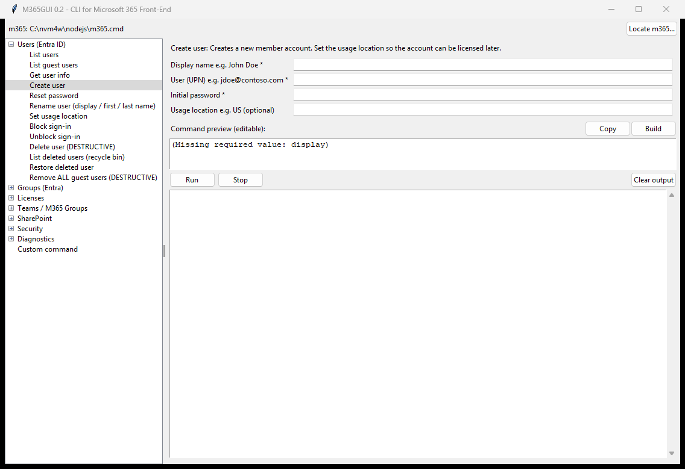

# M365GUI

**A friendly, point-and-click window for the [CLI for Microsoft 365](https://pnp.github.io/cli-microsoft365/) -
the free tool that lets you manage Microsoft 365 and Microsoft Entra ID (users,
groups, licenses, Teams, SharePoint) faster than clicking through the admin
portals.**

M365GUI turns common admin tasks into simple fill-in-the-blank forms, shows you
the exact command it will run **before** it runs, and prints the results in the
window. You get the CLI's power without memorizing any commands. It is the
Microsoft-world counterpart to [GAMGUI](https://github.com/GuruGabe/GAM-GUI-Overlay)
(which does the same for Google Workspace / GAM).


-brightgreen)



---

## New here? Start with this

**What is Microsoft 365 / Entra administration?** If your organization uses
Microsoft 365 (Outlook, Teams, SharePoint, OneDrive) and Microsoft Entra ID
(formerly Azure AD) for accounts, an administrator manages all of it - users,
groups, licenses, devices - from the Microsoft admin portals in a web browser.
That works, but doing the same thing for hundreds of people, one click at a
time, is slow.

**What is the CLI for Microsoft 365?** The
[CLI for Microsoft 365](https://pnp.github.io/cli-microsoft365/) (the `m365`
command) is a free, open-source, cross-platform tool that talks to Microsoft
365 and Entra ID and does those admin jobs in seconds. It is the Microsoft
equivalent of GAM for Google Workspace.

**The catch:** it's a *command-line* tool - you type commands like
`m365 entra user add --displayName "John Doe" --userName jdoe@contoso.com`.
That scares off a lot of people who would otherwise love what it can do.

**That's what M365GUI fixes.** It puts a normal windowed program on top of the
CLI. You pick a task, fill in a couple of boxes, and click **Run**. M365GUI
writes the correct command for you, shows it, runs it, and displays the result.

> [!IMPORTANT]
> **M365GUI does not replace the CLI - it drives it.** You still need the CLI
> for Microsoft 365 installed and signed in on the computer (a one-time setup,
> below). M365GUI stores no credentials of its own; it simply runs *your* `m365`.

---

## What can you actually do with it?

Real jobs M365GUI makes easy. Each links to the matching CLI documentation.

### Manage people (Entra ID users)
- **Onboard:** create an account with a display name, sign-in name, and
  password; set the usage location so it can be licensed.
- **Everyday help-desk:** reset a password, block/unblock sign-in, rename,
  look up a user, list all users or just guests.
- **Offboard:** delete an account, or restore one deleted by mistake (30-day
  recycle bin).
- **Clean up:** remove **all** guest accounts in one guided, confirm-first
  workflow.
- Docs: [entra user](https://pnp.github.io/cli-microsoft365/cmd/entra/user/user-list/)

### Groups
- **List** groups (all, or just Microsoft 365 / security groups), **view** a
  group's details, **create** and **delete** groups, and **add/remove members**.
- Docs: [entra group](https://pnp.github.io/cli-microsoft365/cmd/entra/group/group-list/)

### Licenses
- **See every license** your tenant owns (with used/total and each SKU id).
- **List all users** who have a specific license.
- **Assign** and **remove** licenses.
- Docs: [entra license list](https://pnp.github.io/cli-microsoft365/cmd/entra/license/license-list/)
  | [entra user license](https://pnp.github.io/cli-microsoft365/cmd/entra/user/user-license-add/)

### Teams & SharePoint
- **Add members to a Team**, **list SharePoint sites**, add a user to a
  SharePoint group.
- Docs: [Teams / M365 groups](https://pnp.github.io/cli-microsoft365/cmd/entra/m365group/m365group-user-add/)
  | [SharePoint](https://pnp.github.io/cli-microsoft365/cmd/spo/site/site-list/)

### OneDrive - when someone leaves
- **Copy a user's OneDrive files to another user** (new in 0.4): everything in
  the leaver's OneDrive is copied into a new folder (*Files from jdoe
  MM-DD-YYYY*, or a name you choose) in the OneDrive of the person you name -
  usually their manager. It shows how many files and how much data before it
  starts, asks you once, then counts the files that arrived and saves a CSV
  record of every copy in the `Logs` folder.
- **Nothing is removed** from the original owner, and a file with the same
  name is renamed, never overwritten.
- You need to be a **SharePoint or Global administrator**. M365GUI makes you a
  site admin of both OneDrives for the copy and removes that again afterwards -
  only the access it added (or keep it, if you choose).
- **Find a user's OneDrive address** - empty means their OneDrive has never
  been set up.
- Docs: [spo folder copy](https://pnp.github.io/cli-microsoft365/cmd/spo/folder/folder-copy/)
  | [spo site admin add](https://pnp.github.io/cli-microsoft365/cmd/spo/site/site-admin-add/)

> [!NOTE]
> OneDrive and SharePoint commands need the CLI signed in with **its own Entra
> app** (`m365 setup`, recommended by the CLI since v10). Signed in through the
> Azure CLI's app, Microsoft Graph works but every SharePoint call fails with
> `invalid_request` (401). See [Troubleshooting](#troubleshooting).

### Guided workflows (0.8)
- **Staff hand-off - someone is leaving** (Users): saves a record of their
  groups and licenses, asks once, then - only the steps you set to Yes -
  blocks sign-in, signs them out, copies their OneDrive files to their manager
  (while the license still exists), sets an automatic reply, removes them from
  their groups and removes their licenses (No by default: the mailbox is
  deleted 30 days later).
- **Compromised account response** (Security): blocks sign-in, signs the
  account out everywhere, sets a new random password (shown once, in its own
  window - never in the output or a log), then saves evidence (sign-ins, MFA
  methods, groups, licenses) and `NEXT-STEPS.txt` for what only the admin
  centers can do (inbox rules, MFA methods, sent mail, app consents).
- Records go to the **Records** folder in the settings folder.

### Security
- **Sign a user out everywhere** (revoke sessions) - first move on a
  compromised account - and view **sign-in activity**.
- Docs: [session revoke](https://pnp.github.io/cli-microsoft365/cmd/entra/user/user-session-revoke/)

There's also a **Custom command** box for anything not yet built into a form -
so you're never limited to the built-in tasks.

### Working faster (0.6 - as in GAMGUI)
- **Search** above the task list (any words from a task's name or
  description), **Favorites** (right-click a task) and **Recent** (the last 10
  tasks you ran) at the top of the list.
- **Signed in as** at the top: the account m365 uses (click to check again).
- **Settings > Set up the CLI (install / sign in)...** (0.12, like GAMGUI's
  Set up GAM): Node.js (winget on Windows, the download page elsewhere), the
  CLI (`npm install -g @pnp/cli-microsoft365`), the CLI's app in your tenant
  (`m365 setup`) and signing in (web browser or a code) - each step shows
  whether it is done. It opens by itself only when needed (no CLI, no
  Node.js, nobody signed in, or a command failed because of the sign-in).
  The browser version has a **Set up the CLI...** button at the top:
  **Install the CLI** and **Sign in with a code** run on the server (the code
  and web address appear in the output box); installing Node.js, `m365 setup`
  and the browser sign-in ask questions, so it shows their commands to paste
  into a terminal on the server.
- **Settings > Dark mode** (0.12, as in GAMGUI) - a soft dark gray,
  remembered for next time.
- **Connection** list next to it (0.11, like GAMGUI's Section dropdown): every
  account or tenant the CLI is signed in with is a saved connection - choose
  one and every command after that runs as it. Diagnostics has the matching
  tasks: list, switch, rename and remove connections, sign in another account
  (with a code or in the web browser) and sign out.
- **Pick...** next to user and group boxes - type the start of a name or
  address and choose. Users are searched in Microsoft 365 as you ask; groups
  load once per session.
- **Save results to** a CSV or JSON file for every task that lists things
  (the CLI writes the format; an error is shown, never saved into the file).
- **Run for each CSV row** - the open task once per row of a CSV file; each
  box takes a column or the form's value; test-run the first rows; a record of
  every row goes to `Logs`.
- **Save as script** - the previewed command as a PowerShell `.ps1` or bash
  `.sh` script. Values are passed exactly; Windows PowerShell 5.1 refuses a
  value containing a double quote (it would change it) - use PowerShell 7.
- **Pasted look-alike characters** (curly quotes, invisible zero-width
  spaces) in address and ID boxes are removed before the command is built.

---

## Get it running (the whole path, from zero)

### Step 1 - Install the CLI for Microsoft 365 (one time, required)
M365GUI needs the `m365` CLI installed and signed in. It runs on
[Node.js](https://nodejs.org):

```bash
npm install -g @pnp/cli-microsoft365
m365 login
```

Full guide: [Installing the CLI](https://pnp.github.io/cli-microsoft365/user-guide/installing-cli/)
and [signing in](https://pnp.github.io/cli-microsoft365/user-guide/connecting-microsoft-365/).
Some tasks (like sign-in activity) need extra Graph permissions and/or an Entra
ID P1/P2 tenant - the app notes these where they apply.

> Not sure it's working? Run `m365 status` and `m365 version`. If those succeed,
> you're ready for M365GUI.

### Step 2 - Get M365GUI (prebuilt - no building required)
Go to the **[Releases](../../releases/latest)** page. Every release has an
installer and a portable copy for each system (since 0.5):

| System | Installer | Portable (no install) |
|--------|-----------|-----------------------|
| Windows | **`M365GUI-<version>-Setup.exe`** - installs to Program Files, adds Start Menu and desktop shortcuts and an Add/Remove Programs entry (needs admin) | `M365GUI-<version>-Windows.zip` - unzip anywhere and run `M365GUI.exe` (keep the `_internal` folder next to it) |
| macOS | **`M365GUI-<version>.dmg`** - open it and drag M365GUI into Applications | `M365GUI-<version>-macOS.zip` |
| Linux | **`m365gui_<version>_amd64.deb`** (Debian/Ubuntu: `sudo apt install ./m365gui_*.deb`) or **`m365gui-<version>-1.x86_64.rpm`** (Fedora/RHEL: `sudo dnf install ./m365gui-*.rpm`) - installs to `/opt/M365GUI`, adds the `m365gui` command and a menu entry | `M365GUI-<version>-Linux.tar.gz` |

Each file's **SHA-256** is listed in the release notes.

- **Windows:** the app isn't code-signed, so Windows may warn about an
  unrecognized app; choose **More info -> Run anyway**.
- **macOS:** see [macOS Gatekeeper](#macos-gatekeeper) the first time.

**Updates:** M365GUI checks for a newer version when it starts (turn this off
in **Help**) and asks before doing anything. It downloads the new version,
**checks its SHA-256 against the release notes** - no match, no install - and
restarts itself. An installed Windows copy asks for administrator approval
(it re-runs the new Setup.exe); a portable copy keeps your `m365gui.ini` and
`Logs`. Linux .deb/.rpm installs get the verified package plus the one
command to install it. **Help > What's new** lists what changed.

**Where settings and logs go:** next to the app for a portable copy; for an
installed copy `%LOCALAPPDATA%\M365GUI` (Windows),
`~/Library/Application Support/M365GUI` (macOS) or
`~/.local/share/M365GUI` (Linux).

Prefer to build it yourself? See [Build from source](#build-from-source).

### Step 3 - First launch
- If the top of the window says `m365: (not found)`, click **Locate m365...**
  and point it at your `m365` program (M365GUI finds it automatically when it's
  on the PATH).
- **Try a safe one first:** open **Diagnostics -> Login status** and click
  **Run**. It only reads information - a perfect way to confirm everything works.

New, non-technical users: open **HOW-TO-GUIDE.txt** for a plain-English
walkthrough. **README.txt** is the full reference.

---

## The task list at a glance

| Category | What it's for | Docs |
|----------|---------------|------|
| Users (Entra ID) | List (all / members / guests), get (with manager), create, reset password, rename, job title / department / office, manager, usage location, block/unblock, groups and licenses of a user, invite a guest, check a password, MFA registration report, delete, recycle bin (restore, delete for good, empty), remove all guests | [entra user](https://pnp.github.io/cli-microsoft365/cmd/entra/user/user-list/) |
| Groups (Entra) | List, list by type (4 types), get info, create, rename / describe, list/add/remove members, make an owner, delete | [entra group](https://pnp.github.io/cli-microsoft365/cmd/entra/group/group-list/) |
| Licenses | View all SKUs, list users with a license, assign, remove | [entra license](https://pnp.github.io/cli-microsoft365/cmd/entra/license/license-list/) |
| Teams / M365 Groups | Microsoft 365 groups (with site address, without owners, info, members, roles, remove, deleted and restore, turn into a Team); Teams (list, a user's Teams, settings, create, archive, unarchive, delete, apps installed in a Team, the Teams app catalog); channels (list, add, delete, members) | [m365group](https://pnp.github.io/cli-microsoft365/cmd/entra/m365group/m365group-user-add/) |
| SharePoint | List sites (all, team, communication, with OneDrives), site info, create team / communication site, delete, deleted and restore, site collection admins, lock / read-only, sharing setting, a site's recycle bin, external users, organization settings, add user to a site group | [spo](https://pnp.github.io/cli-microsoft365/cmd/spo/site/site-list/) |
| OneDrive | List every OneDrive, find a user's OneDrive address, copy a user's OneDrive files to another user | [spo folder copy](https://pnp.github.io/cli-microsoft365/cmd/spo/folder/folder-copy/) |
| Security | Compromised account response, sign out everywhere, sign-in activity, Microsoft Entra policies (guest invitations, security defaults, sign-in methods, Conditional Access...) | [session revoke](https://pnp.github.io/cli-microsoft365/cmd/entra/user/user-session-revoke/) |
| Diagnostics | Login status, CLI version, tenant id, organization details, saved connections (list, switch, rename, remove), sign in, sign out | [status](https://pnp.github.io/cli-microsoft365/cmd/status/) |
| Roles and admin units | Admin roles, give someone a role, administrative units and their members | [roleassignment](https://pnp.github.io/cli-microsoft365/cmd/entra/roleassignment/roleassignment-add/) |
| Service health and security | Service health, current issues, message center, security alerts, organization info, enterprise apps and their permission grants, audit log search, retention and sensitivity labels | [serviceannouncement](https://pnp.github.io/cli-microsoft365/cmd/tenant/serviceannouncement/serviceannouncement-health-list/) |
| Outlook | Send an email, mailbox settings, a user's calendars, calendar events and mail folders, automatic replies (on, for dates, off), meeting rooms, room lists | [outlook](https://pnp.github.io/cli-microsoft365/cmd/outlook/mail/mail-send/) |
| Planner | A group's plans, a plan's tasks | [planner](https://pnp.github.io/cli-microsoft365/cmd/planner/plan/plan-list/) |
| Reports (usage) | Active users, Teams, OneDrive (per account and organization total), mail, mailboxes near their size limit and SharePoint usage, 7 to 180 days | [tenant report](https://pnp.github.io/cli-microsoft365/cmd/tenant/report/report-activeusercounts/) |

Plus a **Custom command** mode that accepts any `m365` command
([full command reference](https://pnp.github.io/cli-microsoft365/cmd/docs/)).

---

## Safety and security

M365GUI runs real commands against your live Microsoft 365 tenant. It's built to
be careful, but treat it with respect:

- **It can do whatever your `m365` can do.** M365GUI has no permissions of its
  own - give it to people you trust with that level of access, and think about
  who should have the destructive tasks (delete user/group, remove all guests,
  remove license).
- **You always see the command first,** and destructive tasks pop a
  confirmation. The "Remove all guests" workflow lists everything and makes you
  type **DELETE** before it removes anything.
- **No shell in between (0.4).** M365GUI starts Node with the CLI's own script
  directly. Before 0.4 it went through `cmd.exe` (`m365.cmd`), which treated
  `&` in a value - a folder named *Q&A*, a group named *Sales & Marketing* - as
  the start of another command.
- **Test in a non-production tenant first** when you're learning.
- **Logs can contain user and tenant details** - store and share accordingly.

---

## Browser version (0.9)

`m365_web.py` is M365GUI in a web browser - like GAMGUI's `gam_web.py` - for
a computer with no desktop (Azure Cloud Shell, a server over SSH) or for
anyone who prefers a browser. It has the same tasks, search, Favorites and
Recent, Pick... lists, guided workflows and Run for each CSV row (upload the
CSV); *Save results to* becomes a download.

```bash
python3 m365_web.py            # then open http://127.0.0.1:8080
PORT=8081 python3 m365_web.py  # another port
```

It runs from the source folder (it needs `M365GUI.py`, `m365_catalog.py` and
`m365_workflows.py` next to it) and uses the `m365` you are signed in to.

**Security:** it listens on this computer only (127.0.0.1); every request
needs a secret token that only its own page knows, so other web pages cannot
use it; it accepts JSON only and checks the Host name (DNS rebinding). The
server builds every command itself and refuses a destructive task the page
did not confirm. A remote machine: use SSH port forwarding
(`ssh -L 8080:127.0.0.1:8080 server`), or - when a proxy reaches it under
another name - list that name in `M365WEB_ALLOWED_HOSTS` (comma separated).

## Running and building from source (Windows, macOS, Linux)

M365GUI is a single Python file (`M365GUI.py`) using only the standard library
(tkinter), so it runs on all three platforms. You still need the CLI for
Microsoft 365 installed and signed in (see [Requirements](#requirements)) - it
runs on Node.js and is itself cross-platform.

### Run without building (simplest)

Requires Python 3.10+ **with tkinter**:

- **Windows** - tkinter is included with the python.org installer:
  ```bat
  py M365GUI.py
  ```
- **macOS** - the python.org installer includes tkinter. If you use Homebrew
  Python, add it first with `brew install python-tk`:
  ```bash
  python3 M365GUI.py
  ```
- **Linux** - install tkinter from your package manager, then run it:
  ```bash
  # Debian/Ubuntu:
  sudo apt install python3 python3-tk
  # Fedora/RHEL:
  sudo dnf install python3 python3-tkinter
  # Arch:
  sudo pacman -S tk
  python3 M365GUI.py
  ```

### Build a standalone app (PyInstaller)

Install PyInstaller once: `pip install pyinstaller` (or `pip3 install ...`).

- **Windows:**
  ```bat
  Build-EXE.bat
  ```
- **macOS / Linux:**
  ```bash
  chmod +x build-app.sh
  ./build-app.sh
  ```

Both scripts run `extract_tcl.py` and then PyInstaller in one-folder mode. The
result is `dist/M365GUI/` - copy the whole folder and keep it together (on macOS
you also get a `dist/M365GUI.app` bundle). Run `dist/M365GUI/M365GUI` (or the
`.app`).

Prefer the raw PyInstaller command?

```bash
# Python 3.13 or earlier (Tcl/Tk 8.6):
pyinstaller --onedir --windowed --name M365GUI M365GUI.py

# Python 3.14+ (Tcl/Tk 9): extract the Tcl data first, then bundle it.
python3 extract_tcl.py
pyinstaller --onedir --windowed --name M365GUI \
    --add-data "build_res/_tcl_data:_tcl_data" \
    --add-data "build_res/_tk_data:_tk_data" \
    M365GUI.py
```

macOS/Linux use a colon (`:`) in `--add-data`; Windows uses a semicolon (`;`).

### Why the extract step (Python 3.14+)

Tcl/Tk 9 stores its script library inside the Tcl shared library as a virtual
zip filesystem, which PyInstaller doesn't bundle on its own - without it the app
crashes at startup with `Tcl data directory _tcl_data not found`.
`extract_tcl.py` copies that library to disk (and drops the `.enc` encoding
tables, which some endpoint security blocks) so PyInstaller can bundle it. On
Python 3.13 or earlier you can skip it.

### macOS Gatekeeper

The app isn't code-signed, so macOS may block it on first launch. Right-click the
app and choose **Open**, or clear the quarantine flag:

```bash
xattr -dr com.apple.quarantine dist/M365GUI
```

---

## Troubleshooting

| Symptom | Fix |
|---------|-----|
| Top bar shows `m365: (not found)` | Click **Locate m365...**, or install the CLI so `m365` is on the PATH. |
| `Error: [object Object]` | The CLI is hiding a real error. Re-run the command in **Custom command** with `--debug` added to see the actual message (often a missing Graph permission or a premium-license requirement). |
| "Windows protected your PC" on launch | The app isn't code-signed. Click **More info -> Run anyway**. |
| A command says you're not signed in | Run `m365 login` in a terminal, or **Diagnostics -> Login status** to check. |
| Every SharePoint / OneDrive task fails with `{"error":{"error":"invalid_request"}}` while user and group tasks work | The CLI is signed in through the Azure CLI's app, which SharePoint refuses. Run `m365 setup` in a terminal once: let it **create a new app registration** (needs a Global administrator to approve), choose the full permission set and **scripting** use, then `m365 login` again. |
| OneDrive copy: "Could not read who can manage ..." | You need the SharePoint administrator or Global administrator role, and the fix above. |
| App won't start after unzipping | Keep `M365GUI.exe` and its `_internal` folder together in one folder. |
| `Tcl data directory _tcl_data not found` (building yourself) | Run `extract_tcl.py` before PyInstaller, or just use `Build-EXE.bat`. |

---

## Project files

| File | Purpose |
|------|---------|
| `M365GUI.py` | The application window (standard library only) |
| `m365_catalog.py` | The task catalog and command builder, plus search, Pick..., CSV-row and script helpers |
| `m365_workflows.py` | Guided workflows (OneDrive copy, staff hand-off, compromised account, remove all guests) |
| `m365_web.py` | The browser version |
| `m365_update.py` | macOS / Linux in-app updater and What's new (from GAMGUI) |
| `updatem365gui.ps1` | Windows updater (shipped inside the Windows builds) |
| `installer\` | Inno Setup script (Windows Setup.exe), DMG and deb/rpm build scripts |
| `.github\workflows\build-installers.yml` | Builds all 7 release files on GitHub for a release tag |
| `tests\` | `python tests\test_*.py` - each prints `FAILURES: N` (a fake `m365` - nothing touches your tenant) |
| `extract_tcl.py` | Build helper: bundles Tcl/Tk data for Python 3.14+ |
| `Build-EXE.bat` | One-command build (Windows) |
| `build-app.sh` | One-command build (macOS / Linux) |
| `HOW-TO-GUIDE.txt` | Plain-English guide for non-technical users |
| `README.txt` | Full reference and troubleshooting |
| `CHANGELOG.txt` | Version history |
| `NOTES.md` | Development notes, roadmap, known limitations |

## Contributing

Issues and pull requests are welcome. `M365GUI.py` uses a data-driven task
catalog (the `TASKS` dictionary), so adding a task is a few lines and needs no
new code. Please keep the app dependency-free (standard library only) so it
stays easy to build and audit. Commands were verified against CLI for Microsoft
365 v11; if you add tasks, confirm the syntax with `m365 <command> --help`.

## License and disclaimer

Created by Gabriel Clifton. Licensed under the [Apache License 2.0](LICENSE).

M365GUI runs real administrative commands against a live Microsoft 365 tenant
through the CLI for Microsoft 365. Review the command preview before running,
and test in a non-production tenant first. Provided **as-is, without warranty**.
This is an independent project and is **not affiliated with or endorsed by** the
CLI for Microsoft 365 project, Microsoft, or PnP.
